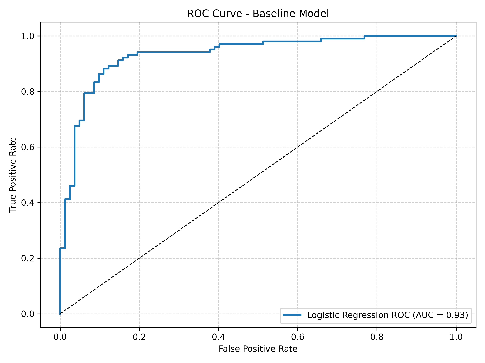
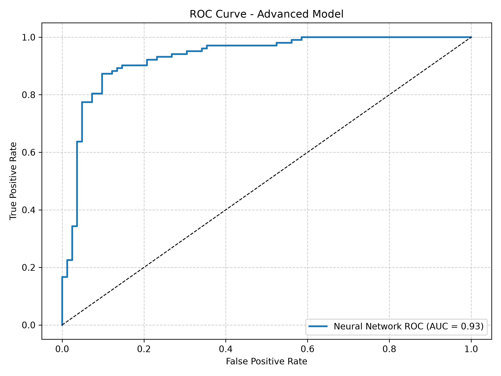
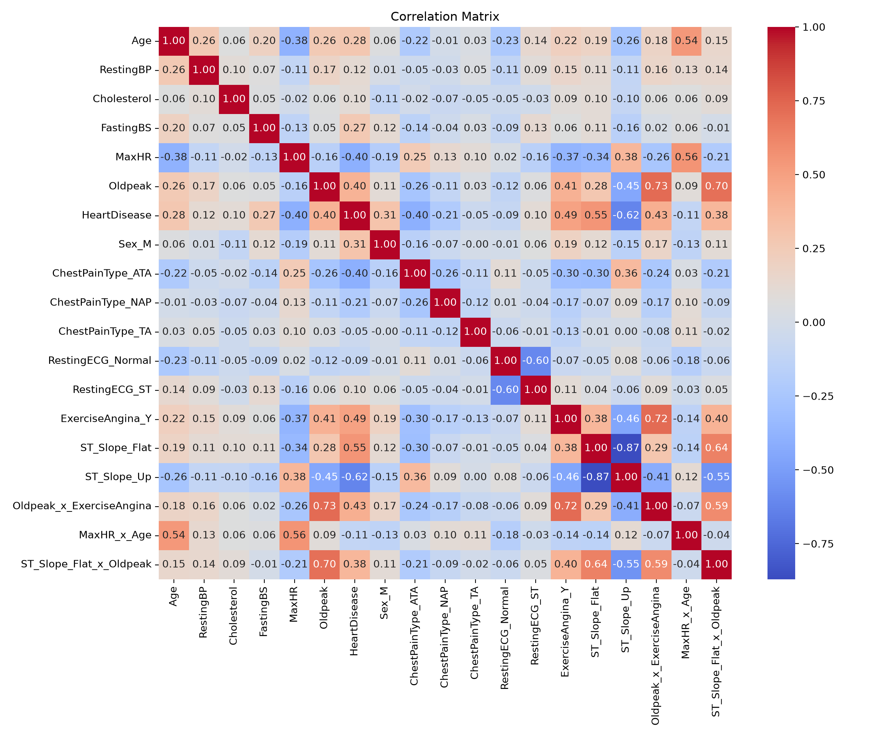
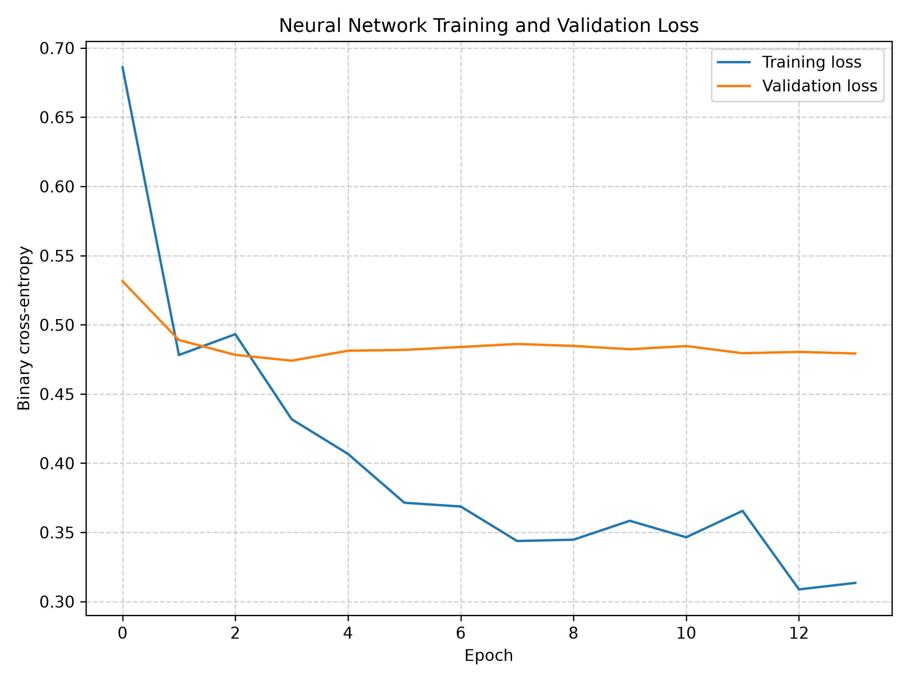

# Heart Disease Classifier

A machine-learning project that compares **logistic regression** with a **feedforward neural network** for binary classification of heart disease using structured patient records. The project dataset is based off of medical datasets from Cleveland, Long Beach, Hungary, and Switzerland sourced from a Kaggle competition (see here to obtain the data : https://www.kaggle.com/datasets/fedesoriano/heart-failure-prediction/data) The project demonstrates data preprocessing, feature engineering, cross-validated hyperparameter tuning, neural-network training, classification-threshold selection, and evaluation on a held-out test set.

> [!IMPORTANT]
> **This project is for educational purposes only — not for clinical or medical use.** This project is **not** intended to be a medical device, diagnostic tool, screening system, or substitute for professional medical assessment. Predictions must not be used to diagnose or rule out heart disease, guide treatment, or make decisions about patient care. Performance on this dataset does not establish reliability in clinical populations.


## Dataset and inputs

The pipeline expects `heart_disease.csv` in the project root ( https://www.kaggle.com/datasets/fedesoriano/heart-failure-prediction/data).

| Feature | Description |
| --- | --- |
| `Age` | Age in years |
| `Sex` | `F` or `M` |
| `ChestPainType` | `ASY`, `ATA`, `NAP`, or `TA` |
| `RestingBP` | Resting blood pressure (mm Hg) |
| `Cholesterol` | Serum cholesterol (mg/dL) |
| `FastingBS` | Indicator for fasting blood sugar > 120 mg/dL |
| `RestingECG` | `LVH`, `Normal`, or `ST` |
| `MaxHR` | Maximum heart rate achieved |
| `ExerciseAngina` | `N` or `Y` |
| `Oldpeak` | ST depression induced by exercise relative to rest |
| `ST_Slope` | `Down`, `Flat`, or `Up` |
| `HeartDisease` | Binary target (0 or 1) |

### Preprocessing and feature engineering

The preprocessing script selects the expected columns, removes exact duplicate rows and rows containing missing values, and applies the shared encoder from `backend/features.py`.

The encoder:

1. Converts zero measurements in `RestingBP` and `Cholesterol` into missing values (`NaN`), since these are not meaningful recorded measurements. Legitimate zeros in other features remain unchanged.
2. Applies one-hot encoding with a fixed, predefined set of categorical levels (`drop_first=True`).
3. Creates three interaction features:
   - `Oldpeak_x_ExerciseAngina = Oldpeak × ExerciseAngina_Y`
   - `MaxHR_x_Age = MaxHR × Age`
   - `ST_Slope_Flat_x_Oldpeak = ST_Slope_Flat × Oldpeak`
4. Saves the encoded data to `data/heart_disease_preprocessed.csv` and a Pearson correlation heatmap to `data/correlation_matrix.png`.

**Important:** Missing values introduced for zero blood-pressure/cholesterol measurements are **not** filled using statistics from the full dataset. Each training pipeline uses a `SimpleImputer(strategy="median")` followed by `StandardScaler`, both fitted on the appropriate training fold. This also ensures the test set is not used to estimate imputation medians or scaling parameters.

## Project structure

```text
project-root/
├── heart_disease.csv                 # Raw dataset 
├── backend/
│   ├── features.py                   # Shared feature encoding
│   ├── data_processing.py            # Preprocessing and correlation plot
│   ├── models.py                     # Model training and threshold tuning
│   └── evaluate.py                   # Held-out evaluation and ROC plots
├── data/                              # Created by preprocessing
│   ├── heart_disease_preprocessed.csv
│   ├── correlation_matrix.png
│   ├── advanced_loss_curve.png
│   └── advanced_preprocessing.pkl
├── baseline_model.pkl                # Saved logistic-regression pipeline
├── advanced_model.keras              # Saved neural network
├── baseline_roc_curve.png
└── advanced_roc_curve.png
```

Other application files (such as a Flask interface) may exist in the repository; they are not required to execute the four pipeline scripts documented here.

## Setup

**Requirements:** A compatible Python installation and the libraries used by the scripts: `numpy`, `pandas`, `matplotlib`, `seaborn`, `scikit-learn`, `scikeras`, `tensorflow`, and `joblib`.

From the project root, create and activate a virtual environment:

**Windows PowerShell**

```powershell
py -m venv .venv
.\.venv\Scripts\Activate.ps1
```

**macOS / Linux**

```bash
python -m venv .venv
source .venv/bin/activate
```

Install dependencies:

```bash
python -m pip install numpy pandas matplotlib seaborn scikit-learn scikeras tensorflow joblib
```

> TensorFlow support varies by operating system, Python version, and hardware. A CPU-only run is sufficient for this small dataset. 

Place `heart_disease.csv` in the **project root**, alongside the `backend/` directory. Run the following commands from that root:

### 1. Preprocess the data

```bash
python backend/data_processing.py
```

Produces:

- `data/heart_disease_preprocessed.csv`
- `data/correlation_matrix.png`

### 2. Train both models

```bash
python backend/models.py
```

This performs hyperparameter searches, fits the selected models, derives the neural-network decision threshold, and saves:

- `baseline_model.pkl`
- `advanced_model.keras`
- `data/advanced_preprocessing.pkl` (fitted imputer, fitted scaler, feature order, and threshold)
- `data/advanced_loss_curve.png` (training and validation binary cross-entropy for the final refit)

Neural-network tuning can take some time because multiple configurations are fitted across cross-validation folds.

### 3. Evaluate the held-out test set

```bash
python backend/evaluate.py
```

Prints classification reports, confusion matrices, sensitivity, specificity, balanced accuracy, ROC AUC, average precision, and Brier scores. Also saves:

- `baseline_roc_curve.png`
- `advanced_roc_curve.png`


## Modeling methodology

### Data partitioning

- **80% training / 20% testing**, using a stratified split and random seed `42`.
- The held-out test set is excluded from hyperparameter tuning, imputer/scaler fitting, and threshold selection.
- Logistic regression uses **5-fold stratified cross-validation**.
- The neural network uses **3-fold stratified cross-validation**.

### Baseline: logistic regression

A scikit-learn pipeline applies median imputation, standard scaling, and logistic regression (`liblinear`, `max_iter=1000`). `RandomizedSearchCV` evaluates `C ∈ {0.01, 0.1, 1, 10, 100}` with ROC AUC as the selection metric. The final classifier uses the standard **0.50** decision threshold.

### Advanced model: neural network

A SciKeras-wrapped TensorFlow/Keras model uses the same imputation and scaling sequence. Its architecture is:

```text
Input
  ↓
Dense(64) → LeakyReLU → BatchNorm → Dropout
  ↓
Dense(32) → LeakyReLU → BatchNorm → Dropout
  ↓
Dense(16) → LeakyReLU → BatchNorm → Dropout
  ↓
Dense(1, sigmoid)
```

The loss is binary cross-entropy. The randomized search samples **10** configurations from batch sizes `16/32/64`, maximum epochs `50/100/150`, optimizers `adam/rmsprop`, and dropout rates `0.2/0.3/0.4`.

**Early stopping** monitors validation loss using a 20% validation split within each neural-network fit, patience of 10 epochs, and `restore_best_weights=True`. This validation subset comes from the training portion of the relevant CV fit; it is not the final test set.

### Neural-network threshold selection

After selecting hyperparameters, the pipeline chooses a threshold maximizing **Youden's index**:

```text
J = sensitivity + specificity - 1 = TPR - FPR
```

The observed threshold for the run reported below was **0.5490**. It is saved with the preprocessing bundle and may change when retraining. This method balances sensitivity and specificity under the chosen criterion; it does **not** encode clinical costs of missed cases versus false alarms. Final performance is reported only on the held-out test set.

## Results

The following results come from one held-out test evaluation of **184 records**: **102 positive** and **82 negative**. They describe performance on this dataset, not expected performance in a hospital or general population.

| Metric | Logistic regression | Neural network |
| --- | ---: | ---: |
| Accuracy | **88.04%** (162/184) | 84.78% (156/184) |
| Sensitivity / positive-class recall | **0.8922** | 0.8039 |
| Specificity | 0.8659 | **0.9024** |
| Balanced accuracy | **0.8790** | 0.8532 |
| ROC AUC | **0.9338** | 0.9310 |
| Average precision | **0.9433** | 0.9325 |
| Brier score (lower is better) | **0.0981** | 0.1016 |
| Positive-class F1 | **0.89** | 0.85 |
| Classification threshold | 0.5000 | 0.5490 |

### Confusion matrices

Rows represent actual classes and columns represent predicted classes, in order `[0, 1]`.

**Logistic regression**

| Actual / predicted | No heart disease (0) | Heart disease (1) |
| --- | ---: | ---: |
| No heart disease (0) | 71 (TN) | 11 (FP) |
| Heart disease (1) | 11 (FN) | 91 (TP) |

**Neural network**

| Actual / predicted | No heart disease (0) | Heart disease (1) |
| --- | ---: | ---: |
| No heart disease (0) | 74 (TN) | 8 (FP) |
| Heart disease (1) | 20 (FN) | 82 (TP) |

### Interpretation

**Discrimination:** Both models have ROC AUC around **0.93**, indicating strong separation of the two recorded classes on this test set. Their AUC difference is just **0.0028**, too small to establish a meaningful superiority without uncertainty estimates or further validation.

**Classification trade-off:** At the evaluated thresholds, logistic regression identifies **91/102** positive cases, compared with **82/102** for the neural network. The neural network makes **8** false-positive predictions versus **11** for logistic regression, but **20** false-negative predictions versus **11**. This is an operating-point comparison: the models use different thresholds, so it does not isolate differences in ranking ability.


### ROC curves





Both ROC curves rise sharply toward the top-left corner, consistent with the AUC values reported above. The dashed diagonal is the chance-level reference. ROC curves summarize behavior across thresholds and should not be confused with performance at the single chosen classification threshold.

### Correlation analysis



The heatmap displays **Pearson correlations** between encoded predictors, engineered interaction features, and the `HeartDisease` target. Selected correlations with the target (read approximately from the supplied plot) are:

| Feature | Correlation with `HeartDisease` |
| --- | ---: |
| `ST_Slope_Up` | -0.62 |
| `ST_Slope_Flat` | +0.55 |
| `ExerciseAngina_Y` | +0.49 |
| `Oldpeak_x_ExerciseAngina` | +0.43 |
| `Oldpeak` | +0.40 |
| `MaxHR` | -0.40 |
| `ChestPainType_ATA` | -0.40 |
| `ST_Slope_Flat_x_Oldpeak` | +0.38 |
| `Sex_M` | +0.31 |
| `Age` | +0.28 |

In this dataset, flat ST slope, exercise-induced angina, and ST depression tend to be positively associated with the positive class; upsloping ST slope and higher maximum heart rate tend to be negatively associated. These are **unadjusted associations**, not causal effects or independent feature-importance estimates. Correlations involving one-hot encoded categories are relative to the encoded category indicators, and engineered interactions are naturally correlated with their source features.

### Neural-network learning curves



This plot illustrates the training and validation binary cross-entropy loss across epochs for the final neural network. Training loss decreases steadily, indicating that the model is learning patterns in the training data. Validation loss initially improves, reaching its minimum around epoch 3, before plateauing while training loss continues to decrease. This divergence suggests some overfitting, as further training does not improve generalization to the validation set. Early stopping terminates training after approximately 14 epochs and restores the weights from the epoch with the lowest validation loss, helping limit overfitting.


## Reproducibility

The scripts use random seed `42` and enable deterministic TensorFlow operations. Exact results can still depend on software versions, platform, numerical libraries, and available hardware. 

---

**Project scope:** A demonstration of applied machine-learning methodology, **not** a medical diagnosis, clinical screening, or treatment system.
